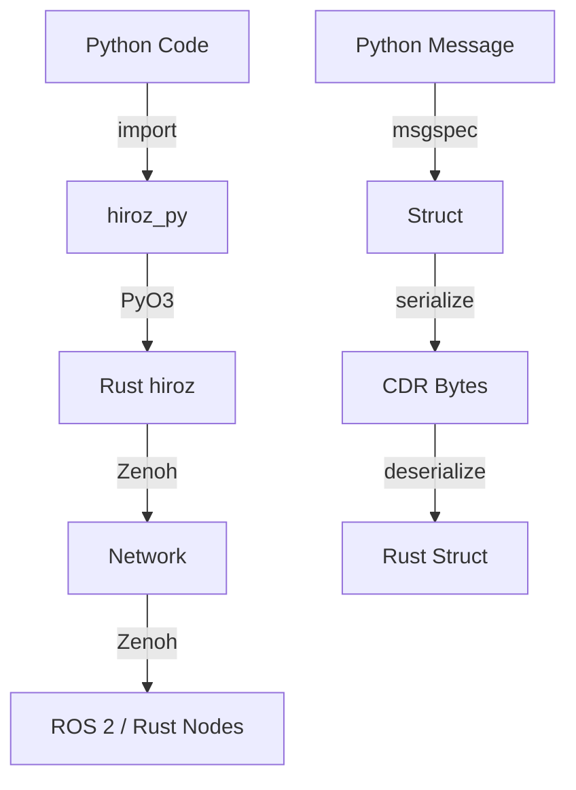

<!-- markdownlint-disable MD046 -->
# Python Bindings

**hiroz provides Python bindings via `hiroz-py`, enabling Python applications to communicate with Rust and ROS 2 nodes using the same Eclipse Zenoh transport.** The bindings use PyO3 for Rust-Python interop and msgspec for efficient message serialization.

!!! note
    Python bindings provide the same pub/sub and service patterns as Rust, with Pythonic APIs. Messages are automatically serialized/deserialized between Python objects and CDR format for ROS 2 compatibility.

## Installation

### Pre-built Wheels (Recommended)

Pre-built wheels are available for Linux (x86_64, aarch64) and macOS (aarch64),
Python 3.11+. No Rust toolchain required.

Pick a release version from the [Releases page](https://github.com/ZettaScaleLabs/hiroz/releases) and substitute `<version>` below (e.g. `v0.2.1`).

**Jazzy / Kilted / Lyrical / Rolling:**

```bash
pip install https://github.com/ZettaScaleLabs/hiroz/releases/download/<version>/hiroz_msgs_py-<version>-py3-none-any.whl
pip install https://github.com/ZettaScaleLabs/hiroz/releases/download/<version>/hiroz_py-<version>-0jazzy-cp311-abi3-linux_x86_64.whl
```

**Humble:**

```bash
pip install https://github.com/ZettaScaleLabs/hiroz/releases/download/<version>/hiroz_msgs_py-<version>-py3-none-any.whl
pip install https://github.com/ZettaScaleLabs/hiroz/releases/download/<version>/hiroz_py-<version>-0humble-cp311-abi3-linux_x86_64.whl
```

!!! tip
    `hiroz-msgs-py` (message definitions) is a dependency of `hiroz-py` and is installed automatically when using `pip install`. The explicit install above is only needed when pinning a specific version or installing from a direct URL.

### Local Dry-Run (before releasing)

To verify the wheel build locally before pushing a release tag, use the build script
which mirrors the CI release workflow exactly:

```bash
# Build jazzy + humble wheels into crates/hiroz-py/dist/
./scripts/build-python-wheels.nu

# Build and immediately install into crates/hiroz-py/.venv
./scripts/build-python-wheels.nu --install jazzy

# Build a single distro only
./scripts/build-python-wheels.nu jazzy
```

The script produces the same wheel filenames as CI (with the `‑jazzy` / `‑humble` distro
suffix) and prints ready-to-use `pip install` commands for the local files.

### Build from Source

For development or platforms without pre-built wheels:

#### Prerequisites

- Python 3.8+
- Rust 1.85+ — install via [rustup](https://rustup.rs): `curl --proto '=https' --tlsv1.2 -sSf https://sh.rustup.rs | sh`
- maturin — `pip install maturin`

#### Setup

```bash
# Create and activate virtual environment
cd crates/hiroz-py
python -m venv .venv
source .venv/bin/activate

# Install message types
pip install -e ../hiroz-msgs/python/

# Build and install hiroz-py
maturin develop
```

!!! tip
    Use `maturin develop --release` for optimized builds when benchmarking or running in production.

## Architecture



## Quick Start

Here's a complete publisher and subscriber example from [`crates/hiroz-py/examples/topic_demo.py`](https://github.com/ZettaScaleLabs/hiroz/blob/main/crates/hiroz-py/examples/topic_demo.py):

### Publisher (Talker)

```python
--8<-- "crates/hiroz-py/examples/topic_demo.py:run_talker"
```

### Subscriber (Listener)

```python
--8<-- "crates/hiroz-py/examples/topic_demo.py:run_listener"
```

## Key Components

| Component | Purpose | Python API |
|-----------|---------|------------|
| **ZContextBuilder** | Configure hiroz environment | `ZContextBuilder().with_domain_id(0).build()` |
| **ZContext** | Manages ROS 2 connections | Entry point for creating nodes |
| **Node** | Logical unit of computation | `ctx.create_node("name").build()` |
| **Publisher** | Sends messages to topics | `node.create_publisher(topic, type)` |
| **Subscriber** | Receives messages from topics | `node.create_subscriber(topic, type)` |
| **Client** | Sends service requests | `node.create_client(service, type)` |
| **Server** | Handles service requests | `node.create_server(service, type)` |


## Service Patterns

Examples from [`crates/hiroz-py/examples/service_demo.py`](https://github.com/ZettaScaleLabs/hiroz/blob/main/crates/hiroz-py/examples/service_demo.py):

### Service Server

```python
--8<-- "crates/hiroz-py/examples/service_demo.py:run_server"
```

### Service Client

```python
--8<-- "crates/hiroz-py/examples/service_demo.py:run_client"
```

!!! tip
    Service servers use a pull model: `take_request()` blocks until a request arrives. This gives you explicit control over when to process requests.

## Action Patterns

Actions extend services with long-running execution, incremental feedback, and cancellation.
A goal is sent by the client, accepted or rejected by the server, executed with feedback
published at each step, and finally terminated with a result.

Examples from [`crates/hiroz-py/examples/action_demo.py`](https://github.com/ZettaScaleLabs/hiroz/blob/main/crates/hiroz-py/examples/action_demo.py).

### Defining Message Types

Actions require three message structs: Goal, Result, and Feedback.
Each must have a `__msgtype__` class attribute:

```python
--8<-- "crates/hiroz-py/examples/action_demo.py:message_types"
```

!!! tip
    Types from `hiroz_msgs_py` already have `__msgtype__` and a ROS 2 type hash. Inline
    `msgspec.Struct` types (as above) use a zero hash and are **Python-to-Python only** —
    they are not compatible with [`rmw_zenoh_cpp`](https://github.com/ros2/rmw_zenoh) typed actions.

### Action Server

```python
--8<-- "crates/hiroz-py/examples/action_demo.py:run_server"
```


#### Server Lifecycle

1. `recv_goal(timeout)` — blocks until a goal arrives; returns `None` on timeout
2. `request.goal()` — deserialize the goal payload
3. `request.accept_and_execute()` → `ServerGoalHandle` — or `request.reject()`
4. `handle.publish_feedback(fb)` — send incremental progress
5. `handle.is_cancel_requested` — poll for client cancellation
6. `handle.succeed(result)` / `handle.abort(result)` / `handle.canceled(result)` — terminate

### Action Client

```python
--8<-- "crates/hiroz-py/examples/action_demo.py:run_client"
```

#### Client Lifecycle

1. `client.send_goal(goal)` → `ActionGoalHandle` — blocks until accepted. It raises on rejection. It raises `RuntimeError` when no server answers: the goal query ends after at most 10 seconds, and a hard limit of 11 seconds applies on top. It never raises `TimeoutError`
2. `handle.recv_feedback(timeout)` — receive next feedback; returns `None` on timeout or when the feedback channel closes
3. `handle.get_result(timeout)` — block until terminal state; returns `None` on timeout. Without `timeout` it has no time limit. The first call consumes the handle, so a timeout cannot be retried: a second call always raises `RuntimeError`
4. `handle.cancel()` — request cancellation (the server decides when to honour it)

### Goal Status

`GoalStatus` constants mirror `action_msgs/msg/GoalStatus`:

| Constant | Value | `is_active()` | `is_terminal()` |
|----------|-------|--------------|----------------|
| `ACCEPTED` | 1 | ✓ | — |
| `EXECUTING` | 2 | ✓ | — |
| `CANCELING` | 3 | ✓ | — |
| `SUCCEEDED` | 4 | — | ✓ |
| `CANCELED` | 5 | — | ✓ |
| `ABORTED` | 6 | — | ✓ |

```python
status = hiroz_py.GoalStatus(handle.status)
if status.is_terminal():
    print("Done:", status)
```

!!! warning
    Python actions use a byte-wrapping wire format that is **not compatible** with
    [`rmw_zenoh_cpp`](https://github.com/ros2/rmw_zenoh) typed actions. Use the Rust `ZAction` trait for ROS 2 interop.

## Complex Messages

Python bindings support nested message types like `geometry_msgs/Twist`:

```python
from hiroz_py import geometry_msgs

# Create a Twist message with nested Vector3
twist = geometry_msgs.Twist(
    linear=geometry_msgs.Vector3(x=1.0, y=0.0, z=0.0),
    angular=geometry_msgs.Vector3(x=0.0, y=0.0, z=0.5)
)

pub = node.create_publisher("/cmd_vel", geometry_msgs.Twist)
pub.publish(twist)
```

## Context Configuration

### Connect to Specific Endpoint

```python
ctx = (
    hiroz_py.ZContextBuilder()
    .with_connect_endpoints(["tcp/192.168.1.100:7447"])
    .build()
)
```

### Disable Multicast Scouting

```python
ctx = (
    hiroz_py.ZContextBuilder()
    .with_domain_id(0)
    .disable_multicast_scouting()
    .build()
)
```

### Custom Namespace

```python
node = ctx.create_node("my_node").with_namespace("/robot1").build()
```

## QoS

`create_publisher` and `create_subscriber` take an optional `qos` argument. The other entity factories (`create_client`, `create_server`, `create_action_client`, `create_action_server`) have no `qos` argument. With no `qos`, an entity uses the `default` profile in the table below.

```python
import hiroz_py
from hiroz_py import std_msgs

qos = hiroz_py.QosProfile(reliability="best_effort", history="keep_last", depth=5)
pub = node.create_publisher("/topic", std_msgs.String, qos=qos)

sub = node.create_subscriber("/topic", std_msgs.String, qos=hiroz_py.QosProfile.sensor_data())
```

### Presets

The module constants `QOS_DEFAULT`, `QOS_SENSOR_DATA`, `QOS_PARAMETERS` and `QOS_SERVICES` are plain `dict` objects, not `QosProfile` objects. Pass one as the `qos` argument, because `qos` accepts a `dict`. The static methods `QosProfile.default()`, `sensor_data()`, `parameters()` and `services()` return `QosProfile` objects with the same values.

| preset | reliability | durability | history |
|---|---|---|---|
| `default` | `reliable` | `volatile` | `keep_last`, depth 10 |
| `sensor_data` | `best_effort` | `volatile` | `keep_last`, depth 5 |
| `parameters` | `reliable` | `volatile` | `keep_last`, depth 1000 |
| `services` | `reliable` | `volatile` | `keep_last`, depth 10 |

All four presets use `automatic` liveliness. Their deadline, lifespan and liveliness lease duration are infinite.

### Constructor arguments

`QosProfile(...)` starts from the `default` profile and overrides each argument you pass. Every argument is optional.

| argument | values | note |
|---|---|---|
| `reliability` | `"reliable"`, `"best_effort"` | |
| `durability` | `"volatile"`, `"transient_local"` | |
| `history` | `"keep_last"`, `"keep_all"` | `"keep_last"` with no `depth` uses depth 10 |
| `depth` | integer greater than 0 | with no `history`, `depth` selects `keep_last`. With `history="keep_all"`, `depth` is ignored |
| `liveliness` | `"automatic"`, `"manual_by_node"`, `"manual_by_topic"` | |
| `deadline` | float, seconds | |
| `lifespan` | float, seconds | |
| `liveliness_lease_duration` | float, seconds | |

A string outside the listed values raises `ValueError`. With `keep_last`, a `depth` of 0 raises `ValueError`. A negative `depth` raises `OverflowError` when Python converts the argument, before the profile checks it.

A profile has read-only properties `reliability`, `durability`, `history` and `depth`. `depth` is 0 for `keep_all`. There are no properties for the other fields.

### Dictionaries

`qos` also accepts a `dict` with the same keys as the constructor arguments, for example `{"reliability": "best_effort", "history": "keep_last", "depth": 5}`. Any other object raises `TypeError`.

!!! warning
    A dictionary key that is not in the table above is ignored without an error, so a misspelled key leaves that field at its default. A `depth` key with no `history` key is also ignored in a dictionary. Use `QosProfile(...)` when you want these mistakes to fail early.

## Shared Memory

Shared memory (SHM) is a property of the context. Enable it on the `ZContextBuilder` before you call `build()`:

```python
ctx = hiroz_py.ZContextBuilder().with_shm_enabled().build()
```

| method | effect |
|---|---|
| `with_shm_enabled()` | creates an SHM pool of 10 MiB |
| `with_shm_pool_size(size_bytes)` | creates an SHM pool of `size_bytes` |
| `with_shm_threshold(threshold)` | sets the message size, in bytes, from which SHM applies. The default threshold is 512 bytes. It has an effect only after `with_shm_enabled()` or `with_shm_pool_size()` |

Pool creation can fail. The failure raises `HirozError`.

### Environment variables

| variable | read by | rule |
|---|---|---|
| `ZENOH_SHM_ALLOC_SIZE` | `with_shm_enabled()` | a positive integer, in bytes, replaces the 10 MiB pool size. Any other value is ignored |
| `ZENOH_SHM_MESSAGE_SIZE_THRESHOLD` | `with_shm_enabled()` and `with_shm_pool_size()` | a positive power of two, in bytes, sets the threshold. Any other value is ignored without an error |

`with_shm_pool_size()` does not read `ZENOH_SHM_ALLOC_SIZE`. A later call to `with_shm_threshold()` replaces a threshold that came from the environment.

## Buffer Group

`create_subscriber` has a `buffer_group` argument. It decides whether the subscriber joins the CPU buffer group of `rmw_zenoh`. A buffer-aware ROS 2 Lyrical publisher sends a message with an unbounded `uint8[]` or `char[]` field to the members of this group on a separate key. The [ROS 2 Interoperability](../user-guide/interop.md#buffer-messages-from-lyrical-publishers) chapter explains the mechanism.

```python
sub = node.create_subscriber("/chatter", std_msgs.String, buffer_group="off")
```

| value | the subscriber joins |
|---|---|
| `"auto"` (default) | on every topic. The Python bindings have no message schema to inspect, so `"auto"` does the same as `"cpu"` |
| `"cpu"` | on every topic |
| `"off"` | never |

A subscriber never joins in two cases, under every value: it uses `transient_local` durability, or its key format is not the one of `rmw_zenoh`.

A value outside the table raises `ValueError`. A value that is not a string raises `TypeError`. The argument works for queue subscribers and for callback subscribers.

Publishers, service clients, service servers and action clients and servers have no `buffer_group` argument in Python.

## Errors

hiroz-py defines four exception classes. All of them are attributes of `hiroz_py`.

| class | base | raised by hiroz-py |
|---|---|---|
| `HirozError` | `Exception` | yes |
| `TimeoutError` | `HirozError` | yes |
| `SerializationError` | `HirozError` | never |
| `TypeMismatchError` | `HirozError` | never |

`hiroz_py.TimeoutError` is not the built-in `TimeoutError`. Catch it as `hiroz_py.TimeoutError`.

Every service client query ends after 10 seconds. A call has no way to wait longer for a reply, so the default `timeout` of one hour is never reached. A `timeout` below 10 seconds raises `hiroz_py.TimeoutError` when no reply comes. A `timeout` above 10 seconds raises `RuntimeError` instead. At exactly 10 seconds either error may happen, because the `timeout` and the 10 second query limit end at the same moment. A call whose query ends with no reply raises `RuntimeError` with the message `Failed to call service: Service call ended before any response was received`. The query lasts at most 10 seconds.

A negative, NaN, infinite or overflowing `timeout` is not supported. An overflowing `timeout` is a value too large for a `Duration`. It does not raise a normal exception: the binding panics and Python raises `pyo3_runtime.PanicException`, which derives from `BaseException`, so `except Exception` does not catch it. Every `timeout` argument that is a float behaves this way.

### What raises what

| situation | result |
|---|---|
| `ZClient.call(..., timeout=t)` with `t` below 10 seconds gets no response in time | `hiroz_py.TimeoutError` |
| `ZClient.call(...)` with no `timeout`, or with `t` above 10 seconds, and no response arrives | `RuntimeError`, after at most 10 seconds |
| `ZClient.call(..., timeout=10.0)` and no response arrives | `hiroz_py.TimeoutError` or `RuntimeError`: either may happen |
| a server answers a `ZClient.call` after the 10 second query has ended | `RuntimeError`. The late reply is dropped |
| `ZClient.call(...)` fails for any other reason, for example the server disappears | `RuntimeError` |
| `ZSubscriber.recv(timeout=t)` gets no message in time | returns `None` |
| `ZActionClient.send_goal(...)` gets no answer from a server | `RuntimeError`, after at most 11 seconds |
| `ZServer.take_request()` or `send_response(...)` fails in the core | `RuntimeError` |
| an action client or server cannot be created, an action call fails in the core, you finish a goal twice, or you call `recv` on a callback subscriber | `RuntimeError` |
| a context, node, publisher, subscriber, service client or service server cannot be created, or a publish or receive fails in the core | `HirozError` |
| a QoS string, a depth of 0 with `keep_last`, or a `buffer_group` value is invalid | `ValueError` |
| a negative `depth` | `OverflowError`, raised by the argument conversion |
| a message class has no `__msgtype__`, or `qos` has the wrong type | `TypeError` |

In the code that converts Python messages to and from CDR, invalid values raise `ValueError` or `TypeError`. They do not raise `SerializationError` or `TypeMismatchError`.

`ZServer.send_response(response, request_id)` needs the `request_id` dictionary that `take_request()` returned. Pass it unchanged. A dictionary without an `sn` or `gid` key raises `KeyError`. A `gid` that does not hold 16 bytes raises `ValueError`.

```python
import hiroz_py

try:
    resp = client.call(req, timeout=2.0)
except hiroz_py.TimeoutError:
    print("no response in 2 s")
except RuntimeError as e:
    print("call failed:", e)
```

## Performance: Zero-Copy Large Payloads

When working with large byte arrays (sensor data, images, point clouds), hiroz-py minimizes memory copies using a zero-copy optimization for `uint8[]` and `byte[]` fields.

### ZBufView

When a subscriber receives a message, hiroz exposes byte array fields as a `ZBufView` — a zero-copy view into the received network buffer. `ZBufView` implements Python's buffer protocol:

```python
msg = sub.recv(timeout=1.0)
# msg.data is a ZBufView — no copy has occurred

# Zero-copy access via buffer protocol
mv = memoryview(msg.data)
header = mv[:8]  # Slice without copying the entire payload

# Only copies when explicitly converted
data = bytes(msg.data)
```

### Echo Without Copying

For relay and echo patterns, pass `ZBufView` fields directly to a new message. The derive macro detects `ZBufView` and extracts the inner buffer via reference counting — no data copy occurs:

```python
# Receive and re-publish — zero-copy for byte array fields
msg = sub.recv(timeout=1.0)
echo = std_msgs.ByteMultiArray(data=msg.data)  # No copy!
pub.publish(echo)
```

### ZBufView API

| Method | Description |
|--------|-------------|
| `len(view)` | Number of bytes |
| `bool(view)` | True if not empty |
| `view[i]` | Single byte access |
| `view[start:stop]` | Slice (returns `bytes`) |
| `memoryview(view)` | Zero-copy buffer protocol access |
| `bytes(view)` | Convert to `bytes` (copies) |
| `view.is_zero_copy` | Whether the view avoids internal copying |

!!! tip
    For best performance with large payloads, avoid calling `bytes()` on `ZBufView` fields. Use `memoryview()` for read access, or pass the `ZBufView` directly when re-publishing.

### How It Works

The optimization operates at three layers:

1. **Deserialization bypass**: When the Python subscriber receives a message, hiroz stores the raw network buffer (ZBuf) in a thread-local. During CDR deserialization, byte array fields create sub-views into this buffer instead of copying (`ZSlice::subslice()`).

2. **Buffer protocol**: `ZBufView` wraps the ZBuf and exposes its bytes to Python via `__getbuffer__`/`__releasebuffer__`. For contiguous buffers (the common case), this is a direct pointer — no copy at all.

3. **Pass-through re-publish**: The `FromPyMessage` derive macro recognizes `ZBufView` inputs and extracts the inner ZBuf via `clone()`, which only increments a reference count on the underlying memory.

## ROS 2 Interoperability

Python nodes interoperate with ROS 2 C++ nodes via the shared Zenoh transport. See the dedicated **[ROS 2 Interoperability](../user-guide/interop.md)** chapter for setup instructions.

## Running Tests

```bash
# Python unit tests
cd crates/hiroz-py
source .venv/bin/activate
python -m pytest tests/ -v

# Python-Rust interop tests
cargo test --features python-interop -p hiroz-tests --test python_interop -- --test-threads=1
```

## Troubleshooting

??? question "Import errors when using hiroz_py"
    This error occurs when the package hasn't been built or installed correctly.
    **Solution:** Rebuild and install the package:

    ```bash
    cd crates/hiroz-py
    source .venv/bin/activate
    pip install -e ../hiroz-msgs/python/
    maturin develop

    ```

??? question "Message type not found"
    This error occurs when trying to use a message type that isn't supported by the Python bindings.
    **Solution:** Check that the class comes from `hiroz_msgs_py` or defines `__msgtype__`.
    `create_publisher` and `create_subscriber` raise `TypeError` when the class has no `__msgtype__` attribute. `hiroz_py.list_registered_types()` returns the registered message type names.

    Ensure you are passing a message class object (e.g., `std_msgs.String`), not a string.

??? question "recv() always returns None"
    This happens when no messages arrive within the timeout period.
    **Solution:**

    - Check the topic name matches exactly (including leading `/`)
    - Verify the publisher is running and connected to the same Zenoh network
    - Increase the timeout value
    - Use `--nocapture` with pytest to see debug output: `python -m pytest tests/ -v --capture=no`

## Resources

- **[Code Generation Internals](./python-codegen.md)** - How hiroz generates Python bindings
- **[Pub/Sub](../core-concepts/pubsub.md)** - Deep dive into pub-sub patterns
- **[Services](../core-concepts/services.md)** - Request-response communication
- **[Message Generation](../user-guide/message-generation.md)** - How message types work
- **[Networking](../user-guide/networking.md)** - Zenoh router setup and options

**Start with the pub/sub example to understand the basics, then explore services for request-response patterns.**
