# ROS 2 Interoperability

hiroz nodes — whether written in Rust, Python, or Go — speak the same Eclipse Zenoh wire protocol as [`rmw_zenoh_cpp`](https://github.com/ros2/rmw_zenoh), the official ROS 2 middleware plugin for Zenoh. This means they interoperate transparently: a Go subscriber can receive messages from a ROS 2 C++ talker, a Python publisher can send to a Rust listener, and so on.

!!! tip "Mixing Humble with Jazzy, Kilted, or Lyrical?"
    If you need to bridge a **Humble** (legacy) network and a **Jazzy / Kilted / Lyrical** (modern) network, use `hiroz-bridge` from [hiroz-toolkit](https://github.com/ZettaScaleLabs/hiroz-toolkit). See the [Cross-Distro Bridge](./bridge.md) chapter for details.

## Prerequisites

- A ROS 2 installation with [`rmw_zenoh_cpp`](https://github.com/ros2/rmw_zenoh) and `demo_nodes_cpp`
- A Zenoh router running on `localhost:7447` (see [Networking](./networking.md))

## How It Works

All participants connect to the same Zenoh router on the local machine.

```mermaid
graph LR
accTitle: ROS 2 interop via shared Zenoh router with Rust, Python, and Go
accDescr: A ROS 2 C++ talker connects through rmw_zenoh_cpp to a local Zenoh router, which also serves hiroz nodes written in Rust, Python, and Go.
    talker["demo_nodes_cpp<br>talker"] --> rmw["rmw_zenoh_cpp"] --> router(["Zenoh router<br>localhost:7447"])
    router <-->|Zenoh| rust["Rust<br>(hiroz)"]
    router <-->|Zenoh| python["Python<br>(hiroz-py)"]
    router <-->|Zenoh| go["Go<br>(hiroz-go)"]
```



!!! note
    The Zenoh router can be [`rmw_zenohd`](https://github.com/ros2/rmw_zenoh), `zenohd`, `hu router`, or Docker.
    See [Networking](./networking.md) for all options.

**Requirements for successful message exchange:**

- Both sides must use the same message type with matching RIHS01 type hashes
- ROS 2 nodes must use [`rmw_zenoh_cpp`](https://github.com/ros2/rmw_zenoh) (`export RMW_IMPLEMENTATION=rmw_zenoh_cpp`)

!!! warning
    If type hashes differ (e.g. mismatched message definitions), nodes silently drop messages.
    Enable `RUST_LOG=hiroz=debug` to inspect the hash in the key expression and compare with the ROS 2 side.
    See [Troubleshooting](../reference/troubleshooting.md) for diagnosis steps.

## Setup

```bash
# Terminal 1 — router
ros2 run rmw_zenoh_cpp rmw_zenohd

# Terminal 2 — ROS 2 talker
export RMW_IMPLEMENTATION=rmw_zenoh_cpp
ros2 run demo_nodes_cpp talker

# Terminal 3 — hiroz listener (see Rust / Python / Go below)
```

---

## Rust

```bash
cargo run --example demo_nodes_listener
```

For more detail on publisher/subscriber patterns see [Pub/Sub](../core-concepts/pubsub.md).

---

## Python

If you installed via **pip** (pre-built wheel), write your own `listener.py` using the code in [Python Quick Start](../bindings/python-quick-start.md) and run it with `python listener.py`.

If you cloned the repository (build from source), use the bundled example:

```bash
cd crates/hiroz-py
source .venv/bin/activate
python examples/topic_demo.py -r listener
```

Or go the other way — Python publishes, ROS 2 listens:

```bash
python examples/topic_demo.py -r talker
# On ROS 2 side:
ros2 topic echo /chatter std_msgs/msg/String
```

For more detail see [Python Bindings](../bindings/python.md).

---

## Go

```bash
just -f crates/hiroz-go/justfile run-example subscriber
```

For more detail see [Go Quick Start](../bindings/go-quick-start.md).

---

## Buffer messages from Lyrical publishers

A claim in this section ends with a marker. The marker `(tested: name)` names the tests that cover the claim. A test checks that each named test exists. It does not check that the named test proves the whole claim. The marker `(not tested)` says that no test covers it.

A ROS 2 Lyrical `rmw_zenoh_cpp` publisher treats an unbounded `uint8[]` or `byte[]` field as a buffer, also inside a nested message (not tested). Examples are `sensor_msgs/Image` and `sensor_msgs/PointCloud2` (not tested). If a matched subscriber announces buffer support, the publisher writes the message on `<topic key>/_buf_cpu` and never on `<topic key>` (tested: `joined_subscribers_receive_from_a_released_publisher`; this test needs a released Lyrical install and skips without one). For each matched subscriber that does not announce it, the publisher also writes `<topic key>/_buf/<gid>` (not tested). The `humble`, `jazzy` and `kilted` branches of `rmw_zenoh` carry no buffer support (they have no `backends` field in the liveliness key-expression code), so the interop tests that need one skip on those distros (not tested).

A hiroz subscriber joins this group when the end of its liveliness token is `backends:cpu:` (tested: `typed_subscriber_with_buffer_fields_joins`). It then reads `<topic key>/**`, which includes the base key and the group key, and drops every other key under the topic key in process (tested: `other_groups_of_the_topic_never_reach_a_joined_subscriber`). The payload is plain CDR (tested: `joined_subscriber_receives_on_the_key_a_real_publisher_writes`). The publisher writes a full payload on `<topic key>/_buf/<gid>` for each matched subscriber outside the group (not tested). The wide subscription receives those writes and drops them, so with K such subscribers a payload reaches the joined process K extra times per message (not tested). This follows from the subscription pattern and is not measured (not tested).

`BufferGroup::Auto` is the default (tested: `default_group_is_auto`, `default_subscriber_joins_a_buffer_topic`). A typed subscriber, a dynamic subscriber or a cache joins when its message has an unbounded `uint8[]` or `byte[]`, directly or nested, or when hiroz has no message definition to ask (tested: `typed_subscriber_with_buffer_fields_joins`, `dynamic_subscriber_joins_for_nested_and_unbounded_byte_fields`, `cache_joins_the_group`, `typed_subscriber_without_schema_joins`). The feedback and status subscribers of an action client have no message definition to ask, so they join under `Auto` (tested: `no_schema_callers_follow_the_rule`). The feedback subscriber stays out when its QoS is transient-local (tested: `action_client_feedback_with_transient_local_qos_stays_out`). The Python bindings build a typed subscriber with no message definition, so they join under `Auto` (not tested). A subscriber with no definition joins on every topic it subscribes to, not only on buffer topics (tested: `no_schema_callers_follow_the_rule`). It declares the wider subscription and the token each time (not tested). To keep the previous token and routing, call `with_buffer_group(BufferGroup::Off)` on the subscriber builder or the cache builder (tested: `opt_out_announces_no_backends`, `opt_out_stays_out_without_a_schema`, `cache_with_group_off_stays_out`). `BufferGroup::Cpu` joins whatever the message is, except for a transient-local subscriber or a custom key expression format (tested: `cpu_joins_a_type_without_byte_fields`, `transient_local_stays_out_even_when_forced`, `custom_key_format_stays_out_even_when_forced`). The action client and the Python bindings have no `Off` switch yet (not tested).

On a raw subscriber, `Auto` deliberately behaves as `Off`, unlike on a typed subscriber without a definition, so it does not join unless you opt in with `Cpu` (tested: `raw_subscriber_without_opt_in_announces_no_backends`, `raw_subscriber_with_group_auto_stays_out`). `create_raw_subscriber` stays out of the group (tested: `raw_subscriber_without_opt_in_announces_no_backends`). `create_raw_subscriber_with_qos` stays out too (not tested). `create_raw_subscriber_with_group(.., BufferGroup::Cpu)` joins, and one callback serves both keys (tested: `raw_subscriber_with_the_opt_in_joins_and_one_callback_serves_both_keys`). With `Off` it stays out (tested: `raw_subscriber_with_group_off_stays_out`). With `Cpu` it still stays out if it is transient-local or uses a custom key expression format (tested: `raw_transient_local_subscriber_stays_out_with_cpu`, `raw_custom_key_format_subscriber_stays_out_with_cpu`). This method exists only with the `ffi` feature, and the Go bindings have no entry point for it yet (not tested). The Go bindings create raw subscribers without the opt-in, so they do not join (not tested).

A transient-local subscriber and a subscriber with a custom key expression format never join, on the default as well as under `Cpu` (tested: `default_subscriber_stays_out_when_transient_local`, `default_subscriber_stays_out_on_a_custom_key_format`, `transient_local_stays_out_even_when_forced`, `custom_key_format_stays_out_even_when_forced`). `rmw-zenoh-rs` subscriptions use `Off`: they do not join yet (not tested).

If you use access control, allow `<topic key>/**` wherever you allow `<topic key>` (tested: `allow_only_base_key_starves_a_joined_subscriber`). A joined subscriber declares `<topic key>/**` (tested: `other_groups_of_the_topic_never_reach_a_joined_subscriber`). A router that allows `<topic key>` and not `<topic key>/**` therefore starves every joined subscriber of that topic, on the base key too: no error is raised and `build` returns `Ok` (tested: `allow_only_base_key_starves_a_joined_subscriber`). A subscriber set to `Off` declares `<topic key>` and keeps receiving (tested: `allow_only_base_key_starves_a_joined_subscriber`). This holds for a subscriber with no message definition on any topic, buffer topic or not (tested: `allow_only_base_key_starves_a_no_schema_subscriber`). A router rule that denies only the group key starves a joined subscriber on a buffer topic, and the base key still delivers (tested: `denied_group_key_starves_silently_while_the_base_key_flows`). A subscriber on a topic with no buffer stays out of the group and receives under the same rule (tested: `non_buffer_topic_still_delivers_under_a_group_key_deny_rule`). A rule on `<topic key>/**` also starves a subscriber set to `Off`, because `<topic key>/**` includes `<topic key>` (tested: `denied_wide_key_starves_a_joined_subscriber`). A Python or action-client user has no `Off` switch, so the only remedy for them is the router rule (not tested). hiroz writes one `info` log line per group key and process when a subscriber joins (tested: `joining_logs_the_group_key_once_per_key`). It remembers at most 1024 keys: a subscriber that joins a key past that limit logs at `debug` level (tested: `join_log_remembers_a_bounded_number_of_keys`). A router that allows only the exact topic key starves default subscribers of buffer topics, with no error (tested: `default_group_is_auto`, `allow_only_base_key_starves_a_joined_subscriber`). Set `BufferGroup::Off` on those subscribers, or allow `<topic key>/**`, to restore delivery (tested: `allow_only_base_key_starves_a_joined_subscriber`).

A subscriber with no `backends:` field receives nothing from a buffer-aware publisher until [ros2/rmw_zenoh#1078](https://github.com/ros2/rmw_zenoh/pull/1078) is released (tested: `mixed_matched_set_delivers_each_sample_once`; this test needs a released Lyrical install and skips without one). This covers `Off` subscribers, transient-local subscribers, subscribers with a custom key expression format and `rmw-zenoh-rs` subscriptions (not tested).
