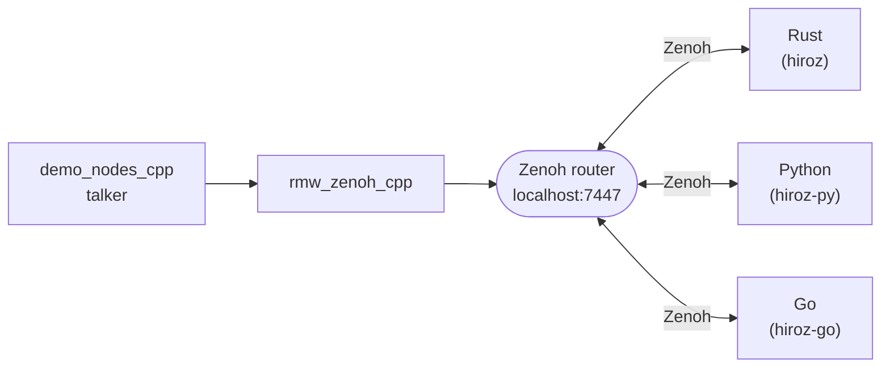

# ROS 2 Interoperability

hiroz nodes — whether written in Rust, Python, or Go — speak the same Eclipse Zenoh wire protocol as [`rmw_zenoh_cpp`](https://github.com/ros2/rmw_zenoh), the official ROS 2 middleware plugin for Zenoh. This means they interoperate transparently: a Go subscriber can receive messages from a ROS 2 C++ talker, a Python publisher can send to a Rust listener, and so on.

!!! tip "Mixing Humble with Jazzy, Kilted, or Lyrical?"
    If you need to bridge a **Humble** (legacy) network and a **Jazzy / Kilted / Lyrical** (modern) network, use `hiroz-bridge` from [hiroz-toolkit](https://github.com/ZettaScaleLabs/hiroz-toolkit). See the [Cross-Distro Bridge](./bridge.md) chapter for details.

## Prerequisites

- A ROS 2 installation with [`rmw_zenoh_cpp`](https://github.com/ros2/rmw_zenoh) and `demo_nodes_cpp`
- A Zenoh router running on `localhost:7447` (see [Networking](./networking.md))

## How It Works

All participants connect to the same Zenoh router on the local machine.



!!! note
    The Zenoh router can be [`rmw_zenohd`](https://github.com/ros2/rmw_zenoh), `zenohd`, `hu router`, or Docker.
    See [Networking](./networking.md) for all options.

**Requirements for successful message exchange:**

- Both sides must use the same message type with matching RIHS01 type hashes
- ROS 2 nodes must use [`rmw_zenoh_cpp`](https://github.com/ros2/rmw_zenoh) (`export RMW_IMPLEMENTATION=rmw_zenoh_cpp`)

!!! warning
    If type hashes differ (e.g. mismatched message definitions), nodes silently drop messages.
    Enable `RUST_LOG=hiroz=debug` to inspect the hash in the key expression and compare with the ROS 2 side.
    See [Troubleshooting](../reference/troubleshooting.md) for diagnosis steps.

## Setup

```bash
# Terminal 1 — router
ros2 run rmw_zenoh_cpp rmw_zenohd

# Terminal 2 — ROS 2 talker
export RMW_IMPLEMENTATION=rmw_zenoh_cpp
ros2 run demo_nodes_cpp talker

# Terminal 3 — hiroz listener (see Rust / Python / Go below)
```

---

## Rust

```bash
cargo run --example demo_nodes_listener
```

For more detail on publisher/subscriber patterns see [Pub/Sub](../core-concepts/pubsub.md).

---

## Python

If you installed via **pip** (pre-built wheel), write your own `listener.py` using the code in [Python Quick Start](../bindings/python-quick-start.md) and run it with `python listener.py`.

If you cloned the repository (build from source), use the bundled example:

```bash
cd crates/hiroz-py
source .venv/bin/activate
python examples/topic_demo.py -r listener
```

Or go the other way — Python publishes, ROS 2 listens:

```bash
python examples/topic_demo.py -r talker
# On ROS 2 side:
ros2 topic echo /chatter std_msgs/msg/String
```

For more detail see [Python Bindings](../bindings/python.md).

---

## Go

```bash
just -f crates/hiroz-go/justfile run-example subscriber
```

For more detail see [Go Quick Start](../bindings/go-quick-start.md).

---

## Buffer messages from Lyrical publishers

A ROS 2 Lyrical `rmw_zenoh` publisher treats an unbounded `uint8[]` field as a buffer, also inside a nested message. Examples are `sensor_msgs/Image` and `sensor_msgs/PointCloud2`. If a matched subscriber announces buffer support, the publisher writes the message only on `<topic key>/_buf_cpu`. A subscriber that reads only `<topic key>` receives nothing, also when it is the one matched subscriber that does not announce buffer support (measured with `rmw_zenoh_cpp` 0.10.6).

A hiroz subscriber that joins the group announces buffer support, with `backends:cpu:` at the end of its liveliness token, and also reads `<topic key>/_buf_cpu`. The payload is plain CDR. A typed subscriber, a dynamic subscriber and a cache join this way. A joined subscriber has one subscription, on `<topic key>/**`, and drops every other key under the topic key in process.

By default (`BufferGroup::Auto`) a subscriber joins when its message has an unbounded `uint8[]`, directly or in a nested message, or when hiroz has no message definition to ask. A message with only a bounded sequence or a fixed array of `uint8`, or with no `uint8[]`, does not join. A schema cannot tell `byte[]` from `uint8[]`, so a message with an unbounded `byte[]` also joins. A joined subscriber that is not needed adds no second subscription to the session.

Call `with_buffer_group` on the subscriber builder to decide for yourself: `BufferGroup::Cpu` joins whatever the message is, and `BufferGroup::Off` does not join.

The cache builder and the action client have no `with_buffer_group`, so they always follow `Auto`.

These subscribers never join, whatever you ask:

- Transient-local subscribers. `rmw_zenoh` serves them on the base key only.
- Subscribers on a custom key expression format.

These subscribers do not join:

- Raw subscribers. There is no way to opt them in.
- `rmw-zenoh-rs` subscriptions. They pass `BufferGroup::Off`.

The feedback and status subscribers of an action client have no message definition, so they join under `Auto`. The Python binding has no message definition either, so it joins under `Auto`. The Python binding has no way to opt out.

hiroz writes one `info` log line for each group key in a process, after it subscribes to the key. hiroz keeps one string for each group key it logged, for the life of the process. If you use access control, allow `<topic key>/**`, which includes `<topic key>/_buf_cpu`, wherever you allow `<topic key>`. A router rule that denies the group key makes a joined subscriber on a buffer topic receive nothing. No error is raised, and the base key still delivers. A topic that is not a buffer topic is not affected.

`BufferGroup::Auto` is the default, and it changes the liveliness token and the routing of existing subscribers. A subscriber set to `Off` has a token with no `backends:` field and reads only `<topic key>`. This is what every subscriber did before `Auto` existed. With `Auto`, a subscriber of a message with an unbounded `uint8[]` field, or of a message with no definition, has a token that ends with `backends:cpu:`, and it also reads `<topic key>/_buf_cpu`. This affects typed subscribers, dynamic subscribers and caches of such messages, the feedback and status subscribers of an action client, and the Python binding. To keep the old token and routing on a subscriber, call `with_buffer_group(BufferGroup::Off)` on its builder. The cache builder, the action client and the Python binding have no way to keep them.

A subscriber whose liveliness token has no `backends:` field receives nothing from a buffer-aware publisher on `rmw_zenoh_cpp` 0.10.5 to 0.10.7, until <https://github.com/ros2/rmw_zenoh/pull/1078> lands. This holds for a buffer topic. A hiroz subscriber set to `Off` and every `rmw-zenoh-rs` subscription have no `backends:` field, so both receive nothing in this case. Measured with a publisher on 0.10.6, a buffer-aware subscriber on 0.10.6 and a legacy subscriber on 0.10.4 shared one topic. The buffer-aware subscriber received 30 of 30 messages and the legacy subscriber received 0 of 30. A legacy subscriber alone received 0 of 30. Each figure is the same in 5 runs, on one host, with 30 `UInt8MultiArray` messages of 64 bytes at 5 Hz. A publisher on 0.10.4 delivered 30 of 30 messages to a legacy subscriber, and to a buffer-aware subscriber, in the same 5 runs. Versions after 0.10.7 are not covered.
